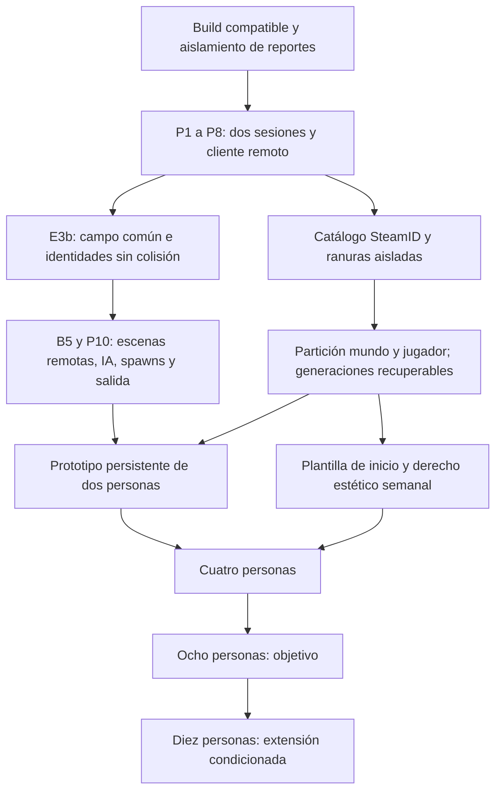

# Visión: un mundo persistente de Crimson Desert con servidor

Investigación del **8 de octubre de 2026**, rama `opcion-d`, build **1.0.0.2976**. Todas las direcciones son RVA, base `0x140000000`, PE timestamp `0x6AB28F00`. SHA-256 del exe: `57da440d72f4db974f25fef047cf84c4dadd999a88cb2a3c5af4c9bd67fde1e7`; [manifiesto](data/vision-manifiesto.json). No se ha ejecutado el juego, compilado, desplegado, modificado código del mod ni leído una partida completa durante esta investigación.

**Estado: síntesis terminada, con contraste independiente propio de las diez afirmaciones críticas: diez confirmadas en su alcance local, ninguna dudosa o falsa.** La revisión, sus precisiones y límites están en §8.1 y en [vision-verifica-sintesis.json](data/vision-verifica-sintesis.json). Los hallazgos estáticos y los diseños conservan los límites de confianza indicados abajo.

**[V]** significa captura u observación histórica identificada; **[E]**, instrucciones legibles de `.rsrc`; **[E-x]**, código protegido de `.xtls`, incluso legible; **[S]**, hipótesis, diseño o cálculo condicionado; **[R]**, fuente externa sin demostrar su correspondencia con el exe. «Programado» describe el repositorio, no evidencia en vivo. Una revisión estática confirmada no convierte [E]/[E-x] en [V]. Las decisiones y estimaciones de este documento son [S] salvo indicación expresa.

> **Alcance revisado (D-36, 2026-10-08): fuera la personalización semanal.** No hay cambio de
> aspecto una vez por semana ni reloj semanal del servidor; T18 queda retirada. Sigue la apariencia
> al entrar por primera vez (alta inicial). Detalle en el [diario](opcion-d-diario.md), D-36.

> **Alcance revisado (D-33, 2026-10-08): el aforo objetivo y máximo es ahora 4 jugadores a la vez.**
> Donde este documento habla de 8 y 10 (tablas de §3, etapas «Ocho» y «Diez» de §4, escenarios
> H=8/H=10 de T20-T21), queda fuera de alcance. Con 4: U=4 (anfitrión jugando) o U=5 (con ancla);
> ~11.900 claves para el mundo con margen; 8-12 Mbit/s de subida juntos (11-16 con ancla), 30
> Mbit/s bastan; 12 entregas de relevo por ronda; 3-4 ranuras de `100-108`; estabilidad exigida
> H=4 durante 24 h. Detalle en el [diario](opcion-d-diario.md), D-33.

## 1. Veredicto por objetivo

**La opción D justifica un prototipo por etapas; todavía no demuestra un servidor persistente jugable con dos personas.** El objetivo de ocho personas se mantiene y diez sigue siendo el techo. El principal límite actual es funcional: compartir campo, simular las zonas alejadas, conservar identidades y separar progreso privado de estado mundial. No hay medición que certifique ocho ni que obligue todavía a reducir ese objetivo. Fuentes: [A0 §§1–3](vision-a0-base.md), [A1 §§1–2](vision-a1-mundo.md), [A2 §§1–2](vision-a2-servidor.md).

| Objetivo del usuario | Veredicto actual | Piezas necesarias y condición de aceptación |
|---|---|---|
| **Un solo mundo** | **Condicionado.** Hay infraestructura multiusuario legible, pero `AddActor` conserva un rechazo de usuario nuevo cuando el campo ya tiene uno [E-x, `0x1064C806`]. | Implementar E3b, después un registro único de campos por nivel y generación del mundo; deduplicar spawns, conservar referencias y decidir el dueño del campo. Dos usuarios deben ver el mismo resultado y un viaje/salida no debe cerrar el campo de los demás. [A1 §§2,8](vision-a1-mundo.md). |
| **Todos se unen; 2 → 4 → 8, techo 10 personas** | **No demostrado en vivo.** El mod actual tiene una sesión adicional y un par de transporte; no una tabla de diez. | Generalizar P1–P8, autenticación, épocas, admisión, destinatarios y colas. Medir juntos y dispersos; §3 separa personas y sesiones. Las cuentas registradas esperan fuera del motor. [A0 §2](vision-a0-base.md), [A2 §§6–8](vision-a2-servidor.md). |
| **PC doméstico dedicado, siempre encendido** | **Plausible con proceso completo y personaje técnico aparcado; servidor sin cliente/renderizado no acreditado.** | Resolver B5/P10: el invitado debe explorar y combatir donde el cliente anfitrión no tiene escena. Comprobar por separado menú, pérdida de foco y minimización; cerrar logout, recuperación y duración. Persistencia en regiones vacías no significa IA continua allí. [A2 §§2–3,7–8](vision-a2-servidor.md). |
| **Partida mundial propia y partida por SteamID; unas 30 cuentas registradas** | **Arquitectura posible, separación segura sin demostrar.** `lobby.save` y `save.save` son usuario y personaje, no mundo y jugador [E, `0x186E606/678`]. | Catálogo autenticado, identidad de personaje coherente, política por componente mixto, raíz exclusiva, arrendamientos de ranura e invalidación demostrada. Publicar generaciones completas y recuperables. Treinta cuentas en disco no son treinta usuarios residentes; tampoco está demostrada la rotación continua de treinta por nueve/diez ranuras. [A3 §§2–4](vision-a3-guardado-mundo.md), [A4 §§2–6](vision-a4-identidad.md). |
| **Todo nuevo jugador empieza justo al comenzar la exploración libre** | **Condicionado; el punto exacto sigue desconocido.** Los nombres de misión y las capturas disponibles no certifican esa frontera. | Fijar primer control libre y primer guardado recargable; preparar una plantilla nativa con historia coherente, identidad propia y sin aplicar el mundo del donante. Registrar si los dos instantes no coinciden; no prometer cumplimiento literal sin medirlo. [A5 §§1–5](vision-a5-inicio.md). |
| **Crear y personalizar una vez por semana** | **Parcial y condicionado.** Hay barbería/protocolo estético; creador libre, recreación completa y cambio arbitrario de cuerpo no acreditados. | Primera modalidad propuesta: alta única desde plantilla y reedición estética sin borrar progreso cada 604.800 s del servidor, por SteamID. Hace falta abrir un flujo válido, autorizar Req 2676, difundir apariencia y confirmar guardado/derecho juntos. La creación completa no se declara resuelta por esta modalidad. [A6 §§1–5](vision-a6-personaje.md), D-30. |

**El permiso para operar o distribuir el servicio es una cuestión separada.** [R] La EULA específica de Crimson Desert y el acuerdo de Steam contienen restricciones pertinentes sobre modificaciones, servidores y retransmisión de protocolos no autorizados; no se encontró permiso para este mod. [S] La viabilidad técnica no permite prometer una distribución pública admitida. [A7 §5](vision-a7-transversal.md), [EULA del juego](https://store.steampowered.com/eula/3321460_eula_0), [acuerdo de Steam](https://store.steampowered.com/subscriber_agreement/).

## 2. Arquitectura mínima y dependencias

El servidor sería el proceso legítimo del juego del anfitrión más un coordinador propio de sesiones, mundo y persistencia. El diseño exige autenticar al miembro por Steam; el catálogo propio sería autoridad de archivos, personaje, derechos y generación. La cuenta u64 del login nativo es un enlace de ejecución cuya retención aún debe demostrarse. `UserLogin` puede poner −1 en `componente+0x78`, mientras relogin compara ese campo con la cuenta recibida [E, `0x2C1759D`, `0x2C17B84–8C`]; no basta cambiar el u64 del paquete. [A4 §2 y revisión C1/C2](vision-a4-identidad.md).

El diagrama expresa dependencias, no componentes ya implementados. En particular, E3b y P9 siguen siendo diseños y P10 no tiene sistema de transferencia. P1–P8 están programados detrás de opciones desactivadas por defecto; el diario registra pruebas históricas fuera del juego, pero no consta validación en vivo de la opción D. **El primer prototipo usa H=2/U=2 con anfitrión participante**, compatible con la única sesión adicional actual. Dos personas externas más un ancla exigen U=3 y generalizar sesiones/transporte antes de ensayarlo; no hace falta esperar al hito de cuatro para hacer esa generalización. [D-32]. Los modos/configuraciones utilizables son los de la guía actual y A0; el antiguo diseño `G1/loopback` de P8 no se presenta aquí como una opción implementada. [A0 §§2–4](vision-a0-base.md), [guía histórica de pruebas](opcion-d-pruebas.md).

| Responsabilidad nueva | Contrato prudente y evidencia que lo exige |
|---|---|
| **Admisión y transporte** | Tabla SteamID → conexión/época → sesión nativa/usuario/ranura; una conexión por miembro, una carga admitida cada vez inicialmente y presupuestos por par/globales. El código actual selecciona un único `peer` y `g_session2`; logout 2001 permanece bloqueado por el túnel. La nueva cola de espera no crea usuarios ni gasta claves. [A2 §§6–7](vision-a2-servidor.md), [A4 §2](vision-a4-identidad.md). |
| **Mundo y campos** | Un mundo lógico puede tener varios `ServerField`, uno activo por nivel/generación compartido por quienes estén allí. E3b inicial sólo reutiliza el campo/nivel del anfitrión; no resuelve otros niveles. La salida del dueño y el cierre por `field+0x2B0==0` exigen ciclo de vida propio y salida nativa. [E/S, `0x2AFEA00`; A1 §§2,8](vision-a1-mundo.md). |
| **IA y regiones vacías** | Un solo cliente competente controla cada NPC, con época y transferencia explícita de estado/aceptación; rechazar mensajes del antiguo controlador. `0x2792A11` lee el dueño; `0x2792A7B` escribe, también cuando conserva el anterior. `ChangeAiControlAck` 2508 contiene sólo actorKey, sin nuevo dueño/época [E, `0x297B430`]. Una región sin cliente mantiene estado durable y política de reposo/respawn; simulación autónoma continua queda pendiente. [A1 §5 y revisión C6/C7](vision-a1-mundo.md). |
| **Identidad de personajes y objetos** | `characterNo` debe ser único y coherente en cargador, lobby, mensajes y cachés: la caché cliente compara número/serie y busca el primer actor coincidente [E, `0xAA8E88`, `0xAA7F41 → 0x8AEB30`]. El generador real de `itemNo` sigue sin localizarse; `_reserveItemNo` es una referencia de `UseItemReserveSlotElementSaveData `, no un contador [E, `0x189D7D0`, RTTI `0x6B43290`]. Bloquear intercambio hasta demostrar IDs y transacción; un catálogo externo no corrige por sí solo una colisión interna. [A4 §3](vision-a4-identidad.md). |
| **Guardado mundial y privado** | Conservar blobs nativos al principio; partición por campo semántico, no por nombre de archivo. `ContentsMisc`, Quest, Sequencer, Transform y otras secciones son mixtas. El inventario estático tiene 47 componentes Server/53 Common, 18 Server con carga/guardado específicos; no demuestra qué objetos están instalados en cada actor. [E/E-x, `0x20688A0`, `0x2069640`, `0x28B7360`; A3 §2 y CSV](vision-a3-guardado-mundo.md). |
| **Transacciones y recuperación** | Cola global de carga/guardado/transiciones; mantener barrera TLS `+0x4460`. El ocupado `+0x60` rechaza, no encola. Publicar un manifiesto sólo tras verificar todos los archivos/pendientes; dos llamadas a `0x2069640` no son dos commits durables: `.xtls 0xEF51850` puede devolver éxito sin escribir. Mundo y jugadores afectados por una transferencia se recuperan juntos. No prometer guardado sin pausa ni ejecutarlo en un hilo ajeno. [A3 §§3–4 y revisión C6/C8/C9](vision-a3-guardado-mundo.md). |
| **Hora, clima y progreso** | Restaurar una vez el tiempo mundial, reanclarlo al proceso nuevo y reanudar desde checkpoint sin adelantar días offline como política inicial. `LoadingCompleteReq=00` evita una copia a `FieldTime 0x6A6D238`, no toda escritura de hora [E, `0x219D8EC`]. Clima por campo tiene ruta propia. Historia personal no puede imponer dos geometrías contradictorias: restricciones explícitas de contenido hasta resolver misiones/stages. [A3 §5](vision-a3-guardado-mundo.md), [A5 §4](vision-a5-inicio.md). |
| **Entrada y apariencia** | Acceso propio «Entrar al mundo» con resumen canónico autenticado; no hacer que el título local seleccione archivos del anfitrión. Plantilla certificada y perfil estético por miembro, con alias/número/forma para distinguir protagonistas. El minimapa actual identifica una única marioneta; necesita generalización para actores nativos. [A4 §4.4](vision-a4-identidad.md), [A5 §3](vision-a5-inicio.md), [A6 §§4–6](vision-a6-personaje.md). |

La historia completa y los jefes con fases son una dependencia propia. `KillActor` entrega el evento inspeccionado a un actor acreditado [E, `0x2943B8B`, `0x2943C9C`]; `JoinPartyOf` exige que ambos actores tengan el mismo controlador [E, `0x2C3CBD4/0x2C3CC08`]. **No está demostrado reparto de XP/botín entre humanos por existir `ToNearAndParty` o `JoinPartyAck`.** Empezar por un encuentro ambiental, medir crédito y recoger una sola instancia de cada bien; las misiones, cinemáticas y fases requieren participantes y elegibilidad explícitos. [A1 §§6–7](vision-a1-mundo.md).

**La primera elección estética depende también del punto de alta.** No está demostrado que la barbería esté disponible justo en la frontera de exploración libre de A5. Si requiere progreso posterior, no adelantar la plantilla, las misiones o los desbloqueos para aparentar que ambos objetivos están resueltos. Quedaría pendiente una vía de edición inicial compatible —por ejemplo, presets cuya aplicación se valide— o una decisión explícita sobre el alcance. [S; A5 §§1–3 y A6 §4]. La barbería está identificada estáticamente, pero ninguna de las ocho capturas contiene Req 2676; no se observó su flujo de edición. [E/V; A6 §§2–3 y revisión §11].

## 3. Aforo realista y límites medibles

**No hay un máximo multijugador demostrado para la opción D.** El siguiente hito verificable es dos personas. La recomendación es conservar ocho como objetivo, llegar a cuatro sólo tras cerrar las puertas funcionales y tratar diez como extensión posterior. «Máximo realista» significa aquí un objetivo condicionado por datos pendientes; sería incorrecto publicar ocho como capacidad probada. El único tope funcional directamente identificado que bloquea ya el mundo común es el de usuario nuevo por campo, pendiente de E3b [E-x, `0x1064C806`; A0/A1].

### 3.1 Personas, sesiones, ranuras y claves

`H` = personas jugando; `U` = sesiones de usuario nativas; `G` = clientes remotos. Con anfitrión jugador: `U=H`, `G=H−1`. Con personaje técnico adicional: `U=H+1`, `G=H`. Se mantiene el sobre prudente **U≤10**; es una decisión de alcance, **no un límite nativo de diez descubierto**. No se propone U=11 para poder llamar «diez» a diez externos más el ancla. [S; D-22; A1 §1, A2 §1].

| H personas | U si el anfitrión juega | Claves restantes antes del mundo | U con ancla adicional | Claves restantes antes del mundo con ancla |
|---:|---:|---:|---:|---:|
| 2 | 2 | 15.299 | 3 | 15.198 |
| 4 | 4 | 15.097 | 5 | 14.996 |
| 8 | 8 | 14.693 | 9 | 14.592 |
| 10 | 10 | 14.491 | 11, fuera del alcance | No se diseña |

Tabla [S] calculada con **15.501−101U**. La reserva de 15.501 y los cien hijos proceden de D0 y su observación histórica; estructura y consumo se contrastan en `0x2A7DEA0`, `0x2A83310` y `.xtls 0x10538980` [E/E-x; A0/A1 verificadas]. La resta no incluye población del mundo y no es aforo garantizado.

Para el PC dedicado con ancla, el máximo de alcance es **nueve externos** con U=10. El pool de trabajo propuesto `100–108,207` tiene diez números candidatos, no diez ranuras seguras. Si 207 no se certifica, sólo quedan nueve de ese pool: **ocho externos más ancla**. Si tampoco se certifican esas nueve, el aforo baja a los arrendamientos que realmente sean seguros. Diez personas exige anfitrión participante o retirada demostrada del ancla, además de diez arrendamientos seguros; la aceptación numérica de 200–205 no los certifica. [S; A4 §4.2 y §5].

### 3.2 Zonas cargadas: el dato que falta es SAM, no el total de paquetes

[V] Ocho capturas reconstruyen máximos visibles de mundo entre 136 y 1.006 claves; 112627 alcanza 821 y 200328 **1.006 a 1.802,573141 s**. En 200328 se acumulan **7.655 claves distintas**, que no estaban todas cargadas a la vez. Un lector independiente reprodujo ambas cifras. [A1 §3 y §12](vision-a1-mundo.md), [datos](data/vision-a1-capturas.json), `C:\Emulador CD\build\research\vision\verificacion\a1\verifica.py`.

[S] El conjunto del cliente **no mide la ocupación global SAM**: hay actores retenidos, fuera del interés, sólo servidor y posibles acompañantes ya contados entre los 101 del usuario. Los IDs de región se superponen; no sumar sus filas. Las distancias de altas tienen P90 cercano a 80 m en dos capturas, pero la extracción de Transform es heurística y **no certifica un radio nativo de 80 m**. [A1 §§3.1–3.4].

La condición de admisión propuesta es `101U + Wreal + M ≤ 15.501`, con `Wreal` medido en SAM y margen inicial **M=3.100** [S, aproximadamente 20%; A1 §4]. Como sensibilidad, sin convertirla en tipos reales de región:

| U sesiones | Presupuesto mundial con M | Si cada zona disjunta costara 1.006 | Si costara 2.000 | Si costara 4.000 |
|---:|---:|---:|---:|---:|
| 2 | 12.199 | 12 zonas | 6 | 3 |
| 4 | 11.997 | 11 | 5 | 2 |
| 8 | 11.593 | 11 | 5 | 2 |
| 10 | 11.391 | 11 | 5 | 2 |

Son divisiones aritméticas [S], no capacidad observada ni un diseño para más de diez personas. Con ocho externos más ancla (U=9), el presupuesto es **11.492**: ocho zonas activas podrían promediar como máximo **1.436,5 claves** cada una si el ancla no añade otra zona; con nueve zonas, **1.276,9**. Con U=10 y diez zonas, **1.139,1**. Ocho zonas a 2.000 ya exceden el presupuesto. Juntos, la unión de spawns podría acercarse a una zona si la deduplicación funciona, a cambio de más reenvío. Sólo medir alta/retirada y mínimos de `SAM+0xD0` cierra estas hipótesis. [A1 §§4,8].

Al agotarse la cola, las rutas inspeccionadas devuelven `eErrNoInvalidActorKey` [E/E-x, `0x2A82D57`, `.xtls 0x105389AE`]. No se demuestra reversión atómica de todo spawn. Cambiar N de 1 a 10 en la inicialización legible añadiría **909 claves**, total 16.410; no multiplicaría el mundo por diez. Es candidato estático con firma en A1, sin habilitar y sin recomendación de uso antes de medir. Primero corregir duplicación/retención y limitar regiones; después auditar todas las cuotas/consumidores si hace falta ampliar. [A1 §4.3; D-25].

### 3.3 Subida doméstica, CPU, memoria y duración

[V] Después de ambos ciclos iniciales, excluyendo recargas y título, las capturas intensas muestran **169,41 kB/s y 400,7 paquetes/s S→C** en 200328, frente a 59,18 kB/s en 112627. El pico inicial 112627 es **5.394.433 B/1 s** y una recarga 200328 llega a **6.555.235 B/1 s**. Son bytes Troc, no caudal de la interfaz física ni una muestra limpia de ocho personas. Los lectores suman tamaño declarado, no bytes copiados del archivo truncado 105149. [A2 §5 y revisión de red](vision-a2-servidor.md), [datos](data/vision-a2-trafico.json).

El modelo de A2 agrega los relevos de humanos y NPC hoy vaciados, más 20% de sobrecarga propuesta, y mantiene sin acotar tráfico adicional. Estos escenarios **no son un intervalo garantizado ni un percentil agregado** [S; A2 §5.2; [cálculos](data/vision-a2-capacidad.json)]:

| H personas | Juntos, anfitrión jugador (Mbit/s) | Juntos, ancla adicional (Mbit/s) | Estrés con ancla / anfitrión jugador |
|---:|---:|---:|---:|
| 2 | 2,6–3,7 | 5,3–7,7 | 15,3 /7,5 |
| 4 | 8,1–11,9 | 11,1–16,3 | 31,5 /23,3 |
| 8 | 20,7–31,2 | **24,18–36,65** | **67,0** /57,8 |
| 10 | **27,8–42,4** | Fuera del alcance con diez externos | — /76,5 |

Con el perfil elegido, **10 Mbit/s de subida no alcanza para ocho**; 30 Mbit/s resulta ajustado y 100 Mbit/s deja margen de red, sin garantizar CPU, Steam, pérdidas o simulación. Ocho ráfagas de 5 MB con 20% de sobrecarga necesitan como mínimo 38,4/12,8/3,84 s a 10/30/100 Mbit/s, antes de juego simultáneo, RTT y carga de escena. El canal propio actual admite 128×1.100=**140.800 B pendientes**: a 100 ms de RTT su envolvente ideal es 1,408 MB/s por enlace. Colas 16/32 MiB no garantizan ese drenaje. [S, A2 §§5–6].

No hay medición responsable de CPU o RAM total para 8/10. El relevo humano juntos tiene hasta `U(U−1)` entregas por ronda: **2/12/56/90** para U=2/4/8/10 y 72 para U=9. Dispersarse baja observadores pero añade escenas/NPC. Los mínimos de objetos nativos y las colas no representan el consumo del motor. Medir por hilo, antigüedad de colas, memoria tras calentamiento, población por controlador, duración de barrera y recuperación de claves. [E/S, `0x2773870`, `0x2BC4F70`; A2 §§4,8].

**Qué límite manda:** primero E3b/B5/P10, identidades, persistencia y contenido; superados éstos, el menor presupuesto observado entre SAM, CPU/colas y subida. No hay un número único por ciudad/región todavía. Un resultado de ocho juntos no certifica ocho dispersos ni un jefe de historia para ocho. [S, A1/A2/A3/A5].

## 4. Hoja de ruta y estimación de esfuerzo

Todos los plazos son **estimaciones [S] de esfuerzo**, no fechas prometidas. Supuestos: un desarrollador con experiencia en C++/MSVC e ingeniería inversa, dedicación efectiva de cinco días por semana, revisiones independientes, acceso del usuario a dos PC/cuentas legítimas y build 2976 estable. El propietario realiza las pruebas en vivo. No incluyen espera de autorización contractual, compra de equipos/cuentas, una reimplementación completa del servidor, evasión de protecciones ni garantizar toda la historia del juego. Dos personas pueden solapar investigación y herramientas; no eliminan las dependencias ni las pruebas que requieren clientes reales.

| Etapa, de menor a mayor riesgo | Trabajo que queda; condición de salida | Pruebas del registro único §5 | Esfuerzo orientativo adicional |
|---|---|---|---|
| **Preparación de evidencia y laboratorio** | Revisar compatibilidad y entorno de reportes; sondas y sesión dormida sin pérdida de datos. Si no se puede aislar el reporte, posponer errores deliberados. | T00–T03 | **3–7 días** para preparar/medir si las rutas conocidas bastan; el aislamiento de reportes puede exigir más investigación. |
| **Dos personas en un mundo temporal** | E2/E3, E3b, P8 real, identidad básica, B5/P10 y salida. El éxito exige que el invitado actúe lejos del anfitrión y sobreviva la salida del controlador, no sólo verse moverse juntos. Prototipo restringido a contenido compatible; aún sin promesa de persistencia. | T04–T10 | **2–6 semanas**. Si B5 requiere sustituir navegación/física o no hay vía legible de transferencia, detener y revisar alcance: no hay estimación finita defendible para esa sustitución. |
| **Dos personas con persistencia propia** | Catálogo SteamID, ranuras aisladas antes de LoginUser, separación mundial/personal, identidades de objetos, generaciones recuperables, hora/clima y rotación de miembros. Cero cruce de archivos, duplicación o retroceso mundial. | T11–T15, y permisos de T19 antes de juego con progreso valioso | **4–10 semanas**. Mayor incertidumbre: campos mixtos, VM de cifrado/cuenta y generación de itemNo; un formato externo propio amplía el plazo. |
| **Alta inicial y perfil semanal** | Fijar frontera libre; certificar plantilla, misión inicial en mundo avanzado y edición estética con recibo durable. Kliff es el primer perfil a validar; comprobar también acceso al editor en el punto inicial. La creación libre completa permanece fuera de lo acreditado. | T16–T18 | **2–5 semanas**, parte solapable con persistencia. No incluye un editor de cuerpos propio ni validar todos los protagonistas. |
| **Cuatro personas** | Tabla de sesiones, P5/transporte por par, banco sintético, presupuestos, contenidos y transiciones concurrentes. Primero carga sintética, luego cuatro clientes reales; cuatro externos necesitan U=5 con ancla. | T19–T21, aplicando escenario H=4 | **2–4 semanas** después del prototipo de dos estable. |
| **Ocho personas: objetivo de diseño** | H=8 con U=9 si hay ancla; ocho clientes reales, regiones separadas, ciudad y combate juntos, guardado/entrada/salida mientras otros juegan. Evaluar treinta registros rotando y al menos 24 h sin crecimiento sostenido. | T20–T21, escenario H=8; T14 ya cerrado | **3–6 semanas** después de cuatro. Sin ocho clientes reales el resultado queda como validación parcial del banco. |
| **Diez personas: techo condicionado** | Confirmar diez arrendamientos, presupuesto real y contenido. El anfitrión cuenta como jugador o se demuestra retirada del ancla; no añadir una undécima sesión. Repetir carga máxima y duración. | T20–T21, escenario H=10 | **1–3 semanas** si ocho tiene margen amplio y no hace falta retirar ancla. Retirarla o resolver otra ranura puede requerir investigación adicional sin plazo cerrado. |

La planificación global es **de meses, no de días**. No sumar las filas como una fecha contractual: hay trabajo solapable, esperas de pruebas y ramas que podrían refutar el enfoque. El criterio para gastar en 4/8/10 es que primero funcionen simulación y recuperación a dos, no que el reproductor acepte más conexiones. [S; dependencias A0–A7].

## 5. Registro único y ordenado de pruebas futuras del usuario

**No se ha ejecutado ninguna de estas pruebas en esta tarea.** Esta es la secuencia consolidada; los nombres E/G/PERS/ID/IN/AP/RPT/PAT conservan trazabilidad hacia los informes originales. Cuando la guía antigua contradiga una puerta nueva —E1 provocando un error sin RPT-0, cambio automático a LoadingComplete 01, copia P9 de vuelta al save personal— prevalecen las condiciones de este registro. No se pide ejecutar ahora `deploy`, cambiar partidas ni activar funcionalidades inexistentes.

**Estado de herramientas:** «existente» sólo significa que A0 encontró código/guiones para ese paso; no que esté probado en vivo. «Nuevo» exige diseño, implementación, revisión y banco fuera del juego **antes** de que el usuario pueda realizarlo. Las pruebas con persistencia emplean únicamente copias de laboratorio y raíz propia; P6 sigue protegiendo las partidas reales. Las operaciones sobre archivos de prueba y la instalación futura se preparan en una tarea autorizada aparte. RPT-0 comprende también lectores y procesos de reporte: una copia de seguridad no impide adjuntar el original.

| Orden / correspondencia | Disponibilidad y preparación | Acción y evidencia mínima | Resultado que decide; detener si falla |
|---|---|---|---|
| **T00 — PAT-1/2 y revisión de alcance** | **Lectura existente; puerta unificada/banco nuevos.** Antes del primer ensayo y al cambiar build. | Cotejar hash/timestamp/base, firmas con sección/entrada y tabla Troc. Una build o perfil alterado debe rechazarse antes de activación/admisión. Regenerar nombres/tipos/canales/tamaños; no basta cambiar opcodes. Revisar permiso/alcance de la operación propuesta según A7. | Fija exactamente qué build y piezas se ensayan. AOB única no valida ABI ni permiso contractual. [A7 §§2,5](vision-a7-transversal.md). |
| **T01 — E0 → E0b** | **Sonda/registro existentes.** Primer ensayo en vivo, tras preparar el entorno. | E0: dos minutos de partida de laboratorio; enlaces sesión/usuario, colas Q0–Q3, crypto apagada, realm y claves libres. E0b: registrar buscadores al moverse cerca de NPC; confirmar vaciado de ExceptOne. | Layout observado coincide con 2976 y no se atribuyen jugadores a los 17 canales del cliente. Si discrepa un puntero/layout, no pasar a escritura. [A0 §3](vision-a0-base.md), guía E0/E0b. |
| **T02 — RPT-0** | **Nuevo aislamiento/auditoría; no existe interruptor de contención certificado.** Precede al error de E1 y a cualquier ensayo de fallo. | Auditar raíces, enumeración `*.save`, archivo auxiliar y materialización/cola del reportero. Usar entorno con sólo datos de laboratorio accesibles por juego y backend, y tratamiento explícito de reportes acordado con el usuario. Validar primero el guardián fuera del juego; sólo después un error controlado en la ranura ficticia. | Ninguna partida real accesible/adjuntable y estado de reportes pendientes conocido. Ausencia momentánea de red o bloqueo de un dominio no basta. Si no se demuestra aislamiento, posponer errores inducidos. [A7 §4](vision-a7-transversal.md), D-28. |
| **T03 — E1** | **Sesión dormida/P6 existentes**, después de T02. | Diez minutos con sesión adicional sin login; un guardado de laboratorio rechazado y respuesta de UI. Registrar vida de sesión, colas, locks y recuperación del error. | Sesión estable, cero Ack al usuario inexistente, sin bloqueo/crash ni escritura personal. Un éxito de E1 no autoriza todavía persistencia. [A0 §2–3](vision-a0-base.md). |
| **T04 — E2** | **Guion existente**, después de T03. | Alta de usuario sintético por loopback: 2319→2840 y 2490→2716, usuario/sesión diferentes, caída de 101 claves. Registrar también carga previa de componentes/ranura y retención de cuenta. | El anfitrión no es sustituido y los Ack van a la sesión correcta. Es laboratorio de identidad, no autenticación Steam del usuario sintético. [A0 §3](vision-a0-base.md), [A4 §2](vision-a4-identidad.md). |
| **T05 — E3** | **Guion/sondas existentes**; partida de laboratorio y anfitrión quieto, sin viaje/muerte concurrente. | Completar dos ciclos nativos con LoadingComplete 00; observar personajes, campo, dueño, usuarios/actores, sector y 32 B FieldTime. | Si campos distintos, confirma necesidad de E3b; no ver a Kliff no refuta por sí solo login. Si 00 se atasca, investigar antes de 01: esa variante puede restaurar hora ajena. Autoguardado rechazado conserva la puerta T02. [A0 §3](vision-a0-base.md), [A3 §5](vision-a3-guardado-mundo.md). |
| **T06 — G0 → G2** | **P8 observe/remote existentes.** Dos PC/cuentas; E2 previo. | G0 instala antes de conectar, observa primer 2319 y crypto apagada. G2, tras anfitrión listo, mantiene invitado 30 s en título; cadena remota completa y usuario local nulo. | Un solo servidor efectivo para esa conexión. **No demuestra escena ni B5.** `G1/loopback` antiguo no se solicita como opción existente. [A0 §3](vision-a0-base.md), [A7 §3](vision-a7-transversal.md). |
| **T07 — E3b → E4** | **E3b nuevo; espejo/P5 existentes para dos.** Implementar y revisar lista/locks/referencias/rollback antes del ensayo. | Mismo campo/generación; users=2, altas recíprocas, contador equilibrado, movimiento aceptado/reenviado y visible. Empezar por diagnóstico sin progreso ni intercambio. | Un mundo compartido básico. No cerrar campo de otro ni incrementar dos veces contadores. Campo distinto invalida la interpretación visual de E4. [A1 §2 y §9](vision-a1-mundo.md). |
| **T08 — ID-1 y parte de ID-2: cuenta/personaje** | **Nuevo catálogo/autenticación/identidad coherente.** El ensayo inicial E2 sólo daba pistas nativas. | A entra/sale/reentra; B con otra cuenta; conexión duplicadaA rechazada antes del motor. Con ambos visibles, números de personaje distintos y coherentes; equipo/serie/caché no cruza entre actores. | Vínculo SteamID→cuenta/usuario/characterNo estable. No aceptar la escritura−1 como fallo demostrado ni el u64 distinto como solución suficiente. Resolver ambigüedad antes de progresión real. [A4 §§2–3](vision-a4-identidad.md). |
| **T09 — G3/E5, B5/P10, G4 y streaming** | **Dos clientes reales; nuevas sondas y transferencia de IA donde haga falta.** Sólo personajes de laboratorio. | Invitado carga escena y combate lejos del ancla; luego dueño de NPC se aleja. Comparar navegación, colisión, objetivo, daño y una sola época/controlador. Entrar al mismo pool A→B/B→A/juntos; retirar A mientras B queda. Probar viaje individual del no dueño/dueño. Por separado menú, desenfoque y minimización 10min. Registrar SAM, carga, reloj y colas. | Resuelve si el cliente anfitrión tiene que cargar todas las regiones, si hay duplicados/cierres y qué estados de ventana mantienen servicio. Si falla, limitar contenido/dispersión temporalmente; no aprobar cuatro por movimiento cercano. [A1 §§5,8](vision-a1-mundo.md), [A2 §§2–3](vision-a2-servidor.md). |
| **T10 — G5: logout, corte y reconexión** | **Nuevo cierre remoto controlado.** Hoy 2001 está bloqueado y P8 no ofrece reconexión completa. | Salida al título, corte de red, cierre del cliente/controlador, reentrada y llegadas de época anterior. Empezar 50 ciclos a dos; medir enlaces, campo/lista, observadores, hijos, SAM y colas hasta limpieza. | Cero huérfanos, doble dueño o mensajes antiguos sobre clave reciclada. No liberar plaza/ranura por cerrar el socket; no usar timer 2063 global para un miembro. [A2 §7](vision-a2-servidor.md), [A4 §2.3](vision-a4-identidad.md). |
| **T11 — PERS-1, G3a/G3b e ID-3: carga aislada** | **P9 invertido nuevo.** Raíz propia, arrendamiento preparado antes de LoginUser y RPT-0. | Dos cuentas y blobs diferentes: cargar por serializador nativo, observar S/gestor/cache/slot y compatibilidad entre cuentas; verificar que no se leen/escriben archivos ajenos. | Compatibilidad de blobs e inicio de aislamiento. No dar por demostrado cifrado independiente de SteamID. Cualquier fallo lleva a investigar, no copiar una clave externa ni cambiar el modo un jugador. [A3 §§1,4](vision-a3-guardado-mundo.md), [A4 §4.1](vision-a4-identidad.md). |
| **T12 — PERS-2/3: mundo y jugador; G3 d/G3e adaptadas** | **Nueva política por campos, cola global y publicación.** No se usa el paso antiguo de P9 que vuelve al save personal. | Traza de vf50/vfD0 y componentes instalados. A/B con hora, quest, vivienda, gimmick e inventario distintos; carga B, cambios personales, guardado y reinicio; repetir orden inverso. Recuperar desde raíz aislada del servidor. | Un solo mundo no retrocede y cada usuario recupera su estado. Los dos archivos forman una generación comprobada; retorno 0 no equivale a publicación. [A3 §§2–4, PERS-2/3](vision-a3-guardado-mundo.md). |
| **T13 — resto de ID-2 y crédito/botín** | **Productor de itemNo y política de recompensa nuevos/auditados.** No habilitar intercambio hasta superar su subcaso. | Adquirir objetos nuevos alternadamente; equipar, vender/recomprar, recoger simultáneamente y reiniciar. A hace daño/B remata, invertir; registrar crédito, experiencia, botín y destinatarios. Probar transferencia sólo cuando tenga transacción implementada. | Instancias y referencias únicas, una muerte autoritativa y concesiones exactamente según elegibilidad. `JoinPartyAck` no sustituye la medición. [A4 §3.2](vision-a4-identidad.md), [A1 §7](vision-a1-mundo.md). |
| **T14 — PERS-4, ID-3/4: ranuras, treinta miembros y título** | **Invalidación/arrendamiento y catálogo remoto nuevos.** Certificar cada número empleado; nunca 3/206. | A→B→A en el mismo slot con pendientes/planos controlados; después rotar 30 registros con aforo de la etapa, sin tenerlos todos residentes. Título/«Entrar al mundo» muestra sólo la identidad autenticada; probar cambio de cuenta del cliente y ausencia de red. | Cero caché/miniatura/inventario ajeno y ranuras reutilizables. Si falla invalidación, sólo quedan arrendamientos ya certificados; reiniciar entre lotes sería solución provisional, no continuidad demostrada. [A4 §§4–6](vision-a4-identidad.md). |
| **T15 — PERS-5/6 y tiempo/clima de PERS-8** | **Coordinador y recuperación nuevos**; T02 cerrado antes de fallos. | Coincidir revive de A/viaje de B/login/autoguardado. El login espera fuera del motor si excede el aforo habilitado: con U=2 no se crea un tercero para provocar concurrencia. Interrumpir en cada fase, simular disco lleno en laboratorio y recuperar última generación completa. Reiniciar, entrar con blob antiguo, dormir/viajar lejos y comparar hora/clima por región. | Transiciones no se pisan, sin bloqueo de barrera, pareja parcial ni duplicación. Hora mundial reanclada una vez y ningún login la sustituye. Medir pausa; no suprimir TLS 4460. [A3 §§3–6](vision-a3-guardado-mundo.md). |
| **T16 — A5-IN1 → IN3: frontera y plantilla** | **IN1: observación nativa; adaptación/alta nuevas.** IN1 puede documentarse antes como trabajo independiente, tras preparar laboratorio/reportes. | Marcar antes del fin introductorio, primer control libre y primer guardado recargable; capturar misiones/stages/guías, inventario, posición y región. Probar plantilla con dos identidades, primera misión, guardado/reinicio y tiempo. | Punto exacto o diferencia explícita si no es guardable; misma progresión inicial sin premios, objetos, tutoriales ni mundo del donante duplicados. No declarar la misión del Abismo frontera por su nombre. [A5 §§1–3,5](vision-a5-inicio.md). |
| **T17 — A5-IN4/5 y jefes/stages** | **Política de contenido nueva.** Plantilla/progreso aislados. | A avanzado cambia puerta/NPC/campamento; B nuevo entra. Luego misión personal, encuentro ambiental y jefe con fases/cinemática; entrada tardía, muerte y reconexión. Medir cámara/input, aggro, finalización y premios individuales. | Un resultado físico y camino de progreso válido para ambos. Restringir los contenidos fallidos; no rebobinar mundo, completar quests por fuerza ni introducir instancias privadas de historia sin una decisión expresa. [A5 §4](vision-a5-inicio.md), [A1 §§6–7](vision-a1-mundo.md). |
| **T18 — AP-1 → AP-6: personalización** | **Barbería identificada en estático; flujo en vivo pendiente. Autorización, difusión, UI propia y derecho semanal nuevos.** Req 2676 está bloqueada hoy por Save*. | Comprobar disponibilidad en la frontera libre antes de ofrecer elección inicial; no adelantar progreso para abrirla. Mapear un control cada vez y cancelar/confirmar; observador presente, reentrada, tintes/equipo e identidad visual. Confirmación repetida y fallo antes/después de commit; reloj −1 d/+8 d/reinicio/rollback. AP-5 de otros protagonistas sólo después de Kliff estable. | Perfil aprobado idéntico en observadores, semana gastada una vez al publicar, cancelación/fallo sin gasto, progreso conservado. Sin hora confiable se suspende sólo confirmar estética. Creador libre y primera elección quedan pendientes donde no se acredite el flujo compatible. [A6 §§3–8 y revisión](vision-a6-personaje.md). |
| **T19 — EXT-1/2: permisos y contención** | **Banco/validación positiva nuevos**, primero sin juego. Las prohibiciones básicas se aplican desde admisión, no se esperan hasta este paso. | Rechazar identidad/slot ajenos, 3/206, build distinta, época vieja, Req indebidas y sobrepresupuesto. Auditar Req permitidas, incluido 2181, y el loopback del anfitrión. No generar una subida CrossSave para probar el bloqueo. Revisar paquete sin archivos/datos no redistribuibles. | Cero operación sobre otro miembro ni elusión por rutas alternativas. Sólo acceso de conocidos hasta cerrar auditoría; un aprobado técnico no autoriza distribución. [A2 §9](vision-a2-servidor.md), [A7 §§4–5](vision-a7-transversal.md). |
| **T20 — escala y red: 2 → 4 → 8 → 10** | **Banco multisesión nuevo.** Diez contextos frente a anfitrión falso; integrado, máximo 9 sintéticos más sesión anfitriona. | Escalar una etapa cada vez: juntos/dispersos, ciudad, NPC, ráfaga mientras otro juega, RTT 20/50/100/200 ms y pérdida 0/1/5% en transporte propio de laboratorio. Luego repetir con H clientes reales. H=8 con ancla exige U=9; registrar aforo/carga exactos. | Claves con margen, colas acotadas/equitativas, CPU/memoria con margen medido y latencia aceptable. Una carga sintética con dos PC no certifica ocho escenas, IA ni identidades Steam reales. [A1 §4](vision-a1-mundo.md), [A2 §§4–6](vision-a2-servidor.md), [A7 §3](vision-a7-transversal.md). |
| **T21 — PERS-7/8 y duración por etapa** | **Instrumentación nueva**, cada etapa sólo tras T20 de su mismo aforo. | H=2 durante 2 h, H=4 durante 8 h, H=8 durante 24 h; H=10 durante **48 h**, después de ocho estable. Registrar U: ancla adicional implica U=H+1; H=10 usa U=10 y ninguna ancla extra. Repetir entradas/salidas normales, viajes, muerte, guardar, zonas vacías y restauración del checkpoint; al menos 100 ciclos a 4/8 como ampliación de T10. Medir tendencias tras calentamiento y percentiles/máximos de pausa. | Cero crecimiento sostenido por reconexión, huérfanos, corrupción o duplicación; capacidad de recuperar mundo y todas las cuentas afectadas. Ampliar a 72 h refuerza evidencia 24/7, sin demostrar estabilidad indefinida ni sustituir revisión de desbordamientos del banco. Criterio consolidado D-32 y [A7 §3.4](vision-a7-transversal.md). [A2 §8](vision-a2-servidor.md), [A3 §6](vision-a3-guardado-mundo.md). |

Los umbrales de latencia y margen son presupuestos a calibrar con T09/T20, no prestaciones descubiertas. A2 propone p99 de despacho adicional<50 ms fuera de cargas y 30% de margen CPU/RAM/subida; A1 propone 3.100 claves libres de reserva. Registrar siempre también máximos y antigüedad de cola: una media buena no compensa una pausa bloqueada. Un error de integridad o identidad detiene el escalado aunque sobre ancho de banda. [S; A1 §4, A2 §4].

## 6. Cinco riesgos que pueden invalidar la visión

| Riesgo decisivo | Evidencia e incertidumbre | Experimento discriminante más temprano | Qué hacer si refuta el enfoque |
|---|---|---|---|
| **1. El mundo necesita la escena/IA del anfitrión y no transfiere control** | IA delegada y dependencia del dueño; 2508 no lleva nuevo dueño. E3b no resuelve navegación, física ni campos remotos. [A1 §§2,5,8; A2 §2]. | **T09**, dos PC: invitado combate en región no cargada por anfitrión; sale el controlador y sigue un único dueño con daño válido. | Limitar temporalmente radio/contenido o investigar transferencia. Si exige sustituir gran parte de simulación protegida, servidor doméstico independiente y dispersión libre dejan de tener viabilidad demostrable. |
| **2. No se pueden separar ni recuperar mundo/cuentas sin contaminación** | Componentes mixtos, gestor/caché por slot, cuenta nativa no cerrada, characterNo repetido e itemNo sin productor identificado; éxito del commit no prueba E/S. [A3 §§1–4; A4 §§2–4]. | **T08/T11/T12**, dos identidades con mundos/inventarios distintos; luego **T14 A→B→A** y corte entre archivos de T15. | Mantener prototipo temporal sin progreso valioso. Sin aislamiento o recuperación no llamar persistente al producto ni rotar 30 cuentas. Podría requerir serializador/partición propios de esfuerzo no acotado. |
| **3. La historia personal y la creación solicitada chocan con un único mundo** | Stages, NPC/geometría y recompensas no son automáticamente compartidos. Frontera libre desconocida; barbería no acredita creador completo. [A1 §§6–7; A5 §§1,4; A6 §§1,4]. | **T16/T17** con novato y mundo avanzado; un jefe con fases; **T18** prueba qué permite crear/editar realmente. | Declarar lista de contenidos/protagonistas compatibles y cumplimiento parcial. Si requiere mundos privados de historia o cuerpo libre incompatible, no presentarlo como la visión literal sin nueva decisión del usuario. |
| **4. Capacidad y ciclo de vida impiden servicio 24/7** | SAM limitado, colas/refcounts, salida protegida y temporizador sin plazo cerrado; ventana de red/RTT, CPU no medida y Req con autorización incompleta. [A1 §4; A2 §§4,6–9]. | **T10**, 50 ciclos a dos, y **T20** con una ráfaga a par lento mientras otro juega; medir SAM/colas/barrera. | Bajar aforo operativo al último probado, contener admisiones/regiones y corregir fugas/equidad. Reinicios recuperables programados pueden ser operación provisional, pero no prueban estabilidad continua ni permiten desconocidos. |
| **5. Reportes, actualizaciones o restricciones externas impiden operar/distribuir** | Fallos de guardado pueden preparar adjuntos `*.save` [E/E-x]; código/RVAs ligados a 2976; EULA restringe usos pertinentes [R]. No se observó envío ni hay permiso específico. [A7 §§2,4–5]. | **T00/T02** antes de errores deliberados; aislamiento verificable de lectores/reportero y revisión de fuentes/permiso aplicable. Una prueba técnica no puede resolver por sí sola una restricción contractual. | Posponer fallos si no se aísla; desactivar opción D ante build desconocida; mantener sin distribución pública hasta resolver su alcance. No evadir DRM ni interpretar una AOB/API como permiso. |

Los cinco riesgos interactúan: aumentar claves no crea IA, más subida no corrige identidad y un checkpoint íntegro no vuelve compatible una misión contradictoria. Se investigan primero con dos clientes para evitar desarrollar la escala de un modelo que luego resulte inviable. [S; dependencias de §2].

## 7. Decisiones consolidadas para versionado

Este registro conserva las decisiones de la sección «Decisiones» del [diario](opcion-d-diario.md) dentro de un archivo `vision-*.md`, admitido por la lista de rutas de commit del usuario. El diario se actualiza en el worktree; su ruta queda fuera de esa lista estricta y no se incorpora al commit. No se cambian aquí las decisiones históricas ni se interpreta una propuesta como función ya disponible.

| Decisión | Elección prudente y motivo | Evidencia principal |
|---|---|---|
| **D-22** | Investigación estática, objetivo 8/techo 10 condicionado; separar H/U, contabilizar ancla y no diseñar once sesiones. Evita prometer aforo por protocolo o replay. | A0 §§1–3; A1 §1; manifiesto/firma 2976. |
| **D-23** | Cola global de carga/guardado/transiciones y conservar TLS 4460; ocupado nativo rechaza. No levantar P6 hasta aislamiento/recuperación. Evita serializar estado cambiante o pisar temporales de otro usuario. | A3 §3; `0x186F6BF`, `0x2C35F35–0x2C35FC4`. |
| **D-24** | Blobs nativos y raíz propia; generaciones completas verificadas, manifiesto y rollback conjunto. No reutilizar ranura sin invalidación demostrada. Dos llamadas no prueban durabilidad. | A3 §§1.2,4; A4 §6. |
| **D-25** | No ampliar reserva todavía ni tratar 2508 como transferencia. Medir SAM; dueño con época necesita estado, aceptación y descarte de mensajes viejos. | A1 §§4–5; `0x297B430`. |
| **D-26** | Una carga admitida cada vez inicialmente, presupuesto global/por par y acceso de conocidos; B5/IA/salida antes de cuatro. La subida nominal y la identidad Steam no garantizan capacidad ni honestidad. | A2 §§5–9; contraejemplo 2181. |
| **D-27** | Catálogo autenticado durable; characterNo coherente; no usar `_reserveItemNo` como contador; bloquear intercambio hasta ID-2. Preparar ranura antes de LoginUser y probar A→B→A. | A4 §§2–4; `0x2C17881`, `0x8AEB30`. |
| **D-28** | RPT-0 precede error de E1 y fallos de persistencia. P6 no bloquea lecturas/adjuntos; aislar enumeración, rutas y procesos de reporte. No implica transmisión observada ni permiso contractual. | A7 §4; `0x2356270 → 0x1317D40`. |
| **D-29** | Plantilla nativa certificada en frontera medida; mantener progreso coherente y excluir mundo del donante. No completar quests/stages para ocultar incompatibilidad. | A5 §§1–5. |
| **D-30** | Primera modalidad: alta y reedición estética cada 604.800 s desde confirmación durable, por SteamID y sin borrar progreso. Recibo idempotente; fallo/cancelación no gasta; reloj incoherente suspende sólo nuevas confirmaciones. Recreación libre sigue pendiente. | A6 §§1,3–5. |
| **D-31** | Perfil de build exacto para activar/admitir; verificar contratos además de firmas/nombres. Replay sintético no certifica clientes reales y la API no autoriza operar/distribuir. Mantener alcance privado mientras se resuelven condiciones. | A7 §§2–5. |
| **D-32** | Esta secuencia prevalece sobre guías históricas sin las nuevas puertas. H=2/4/8/10 durante 2/8/24/48 h, respectivamente; U explícito y 72 h como ampliación. Primer prototipo H=2/U=2 con anfitrión participante; dos externos más ancla requieren U=3 y generalización. Un login que supera aforo espera fuera del motor. Son criterios futuros, no prestaciones observadas. | A0–A7; §5 T20/T21. |

No se añade un hook nuevo en esta síntesis. Los candidatos de los informes conservan primeros bytes, límite de función, sección y AOB única para 2976 en [catálogo común](data/vision-firmas-2976.json), [A1](data/vision-a1-firmas.json) y [A6](data/vision-a6-estatico.json). Son candidatos, no garantías de ABI/seguridad ni firmas portables. `0x35BAD4` es interior de `0x35B800`: sólo el mid documentado; ninguna propuesta apunta a `.xtls` ni a su thunk como atajo.

## 8. Diez afirmaciones críticas para el verificador de esta síntesis

El contraste debe leer nuevamente el exe 2976, intentar refutar estas proposiciones locales y corregir este documento. No basta que un informe anterior diga «confirmada». Las hipótesis negativas globales, capacidad, cifras de calendario, legalidad y ausencia de transmisión no se pueden certificar desensamblando diez funciones.

| ID | Afirmación E/E-x, con alcance acotado | Puntos para repetir el contraste; informe de origen |
|---|---|---|
| **S-C1** | AddActor aplica tope 1 al usuario ausente; la rama que ya encuentra al usuario lo salta. Esto sustenta E3b, no prueba que la preinserción funcione en vivo. | [E-x] `0x1064C7E8–0x1064C821`, especialmente `0x1064C806`; A1-C5. |
| **S-C2** | Initialize suma 100N y N a cuotas; las rutas de reserva inspeccionadas usan cola común y fallan al estar vacía. No demuestra límite global de usuarios ni certifica 15.501 por sí solo. | [E] `0x2A7DEDB/DEF6/E044`, `0x2A82D57–63`; [E-x] `0x105389AE–C2`; A0-C1/C2, A1-C1/C2. Los valores iniciales/cien hijos mantienen fuente D0 histórica. |
| **S-C3** | El escritor de ChangeAiControlAck 2508 sólo serializa actorKey u32, sin nuevo dueño ni época. | [E] `0x297B511–524`, `0x297B553`, `0x297B5F7–623`; A1-C7. No acredita ausencia de otra migración nativa desconocida. |
| **S-C4** | Timer 2077 pide y espera barrera de hilos activos, guarda y limpia al retorno normal; no aparece timeout en esa espera. | [E] `0x2C35F35`, `0x2C35F74–94`, `0x2C35FC4`; vínculo TLS `0x277343A`, `0x2773500–24`; A2-C2/C3 y A3-C8. No prueba pausa de menú ni liberación tras excepción. |
| **S-C5** | Guardado llama por separado con usuario y personaje a `0x2069640`, pero el commit protegido puede devolver éxito sin E/S por flags del objeto de ranura. | [E] `0x186E606`, `0x186E678`, `0x2069CE3`; [E-x] `0xEF5185A–81`, `0xEF51B2A–39`; A3-C6. No llamar a esas dos llamadas commits durables. |
| **S-C6** | ContentsMisc refiere FieldSaveData, gimmicks/eventos y vivienda; el recorrido por componentes carga vf50 y produce guardado vfD0, sin una partición explícita por mundo/jugador en ese bucle. | [E] `0x28B8CDB → 0x18CE210`, `0x18CE266/292/2FA`, `0x28BF989`; `0x2069018–27`, `0x20693E8`, `0x20697E1`; A3-C3/C4/C7. Nombres de datos no prueban singleton global. |
| **S-C7** | La caché de equipo compara characterNo/serie y Apply busca el primer coincidente por número; esa clave puede ser ambigua entre usuarios. | [E] `0xAA8E88/8E`, `0xAA7F41 → 0x8AEB30`, `0x8AEC6C–90`; A4-C4. El primer coincidente puede terminar vacío; no atribuir automáticamente un fallo visual histórico. |
| **S-C8** | `_reserveItemNo` pertenece a UseItemReserveSlotElementSaveData y su setter copia el valor; no es evidencia de un contador de nuevos objetos. | [E] `0x189D5D2`, descriptor `0x189D7D0`, vt `0x5891460`, COL `0x5EA9FE8`, TypeDescriptor `0x6B43280` y cadena RTTI `0x6B43290`; A4-C5. No demuestra dónde está el productor real. |
| **S-C9** | La respuesta explícita de la edición 2676 usa ToTarget, mientras otra ruta sólo emite ToNear tras éxito y flag no nulo; no está probada la difusión de la edición a todos. | [E] `0x294B21B–0x294B24F`, vt `0x5B25438`; [E-x] `0x10446597`, `0x104465AE–BC`, `0x10446614`, vt `0x5B25418`; A6-C3/C4. Mantener límite frente a efectos indirectos. |
| **S-C10** | Fallos load/valid/save/delete de commit pueden llamar al reporte que enumera archivos de esa ranura y solicita adjuntos/evento al SDK; existen condiciones de flags/contador/activación/scope. | [E-x] `0xEF51913/19B8/1A63/1B07`; [E] `0x2356270`, `0x2356291`, `0x2356434`, `0x1317E24/91`; A7-C1/C2. En `0x2356270`, RCX=M y R8=S: H=[M+0x10], nombre S+0x28. No afirmar enumeración de todas las cuentas ni envío externo observado. |

Además de esas diez: verificar aritmética de §3, cifras de fuente de capturas, distinción H/U/G, la condición de ranura 207, orden RPT-0→E1, ausencia de instrucciones para funciones inexistentes y correspondencia de decisiones con diario. La reproducción independiente de capturas de A1/A2/A6 se conserva en sus JSON; esta síntesis no dice haber reejecutado sus lectores.

### 8.1 Resultado del contraste independiente de la síntesis

El agente verificador volvió a leer el exe en disco, calculó su hash y decodificó las instrucciones con un script propio; no reutilizó los volcados de los autores como prueba. Coinciden los **384.521.624 B**, SHA-256 de la cabecera, timestamp `0x6AB28F00` y base `0x140000000`. Se leyeron directamente los COL, TypeDescriptors, cadenas e imports necesarios. Script y volcados: `C:\Emulador CD\build\research\vision\verificacion\sintesis\verifica.py`, `C1.txt`–`C10.txt`, `lecturas.json` y `calculos.json`; resumen reproducible versionado en [vision-verifica-sintesis.json](data/vision-verifica-sintesis.json). Ninguna lectura estática se eleva a [V].

| Afirmación | Resultado | Contraste, intento de refutación y límite conservado |
|---|---|---|
| **S-C1** | **Confirmada [E-x]** | `0x1064C7E8/7EB` compara el usuario y salta a `0x1064C813`; la ruta sin coincidencia alcanza `cmp [field+0x2A8],1` en `0x1064C806`. El rechazo también depende del estado `field+0x4A`. Preinsertar evita esta comparación local, pero no demuestra que todas las invariantes de AddActor queden satisfechas. |
| **S-C2** | **Confirmada [E/E-x]** | `0x2A7DEDB` calcula 100N; `0x2A7DEF6` y `0x2A7E044` lo suman junto a N. `0x2A82D57/63` y `.xtls 0x105389AE/BA` comprueban `+0xD0` y usan el mismo error `0x6CDB9E4` al vaciarse la cola; las extracciones usan `+0xC8/+0xD4/+0xE0`. Ni el total inicial histórico ni una reversión global del spawn se deducen sólo de esas instrucciones. |
| **S-C3** | **Confirmada [E]** | Ambas ramas del escritor toman `actor+0x60` y escriben 4 B (`0x297B511–524`, `0x297B5F7–623`); la segunda reserva 9 B con la cabecera. No aparece un campo de nuevo dueño ni época en este mensaje. No se concluye que toda migración nativa sea imposible. |
| **S-C4** | **Confirmada [E]** | `0x2C35F35` solicita la barrera; `0x2C35F74–7E` espera a los activos sin acuse; `0x2C35FD8–FE3` duerme y vuelve sin plazo visible. Tras la llamada de guardado `0x2C35F94`, `0x2C35FC4` retira la petición al retorno normal. El servidor usa TLS `+0x4460` en `0x277343A/3500–3524`. Menú, excepciones y latencia siguen fuera de lo probado. |
| **S-C5** | **Confirmada [E/E-x]** | Las llamadas `0x186E606/678` reciben objetos distintos: usuario desde `personaje+0xA0` y personaje. `0x2069CE3 → 0x2355700` entra en `.xtls 0xEF51850`. Las condiciones de `S+0x69C/+0x699/+0x698` pueden saltar directamente a `0xEF51B2A`, cuyo `mov al,1; ret` confirma éxito sin pasar por E/S. No hay prueba de atomicidad ni durabilidad de la pareja. |
| **S-C6** | **Confirmada [E]** | Se resolvió la vtable `0x58AF0E0` como `FieldSaveData`; las cadenas de `0x57DE190`, `0x57DE110` y `0x57E1D28` identifican gimmicks, eventos globales y vivienda en las rutas citadas. El bucle lee `actor+0x78/+0x80`, carga por vf50 (`0x20693E8`) y produce datos por vfD0 (`0x20697E1`). No clasifica explícitamente mundo/jugador en ese bucle; cada componente aún puede imponer reglas propias. |
| **S-C7** | **Confirmada [E]** | `0xAA8E88/8E` compara número y serie; `0xAA7F41` consulta `0x8AEB30` por número. Tras el primer número coincidente (`0x8AEC70/73`), la rama de elegibilidad puede devolver vacío (`0x8AEC8B/90`) sin buscar otro coincidente. La ambigüedad es un riesgo sustentado, no un fallo visual ya observado. |
| **S-C8** | **Confirmada [E]** | El setter copia `[rdx]` a `objeto+0x48` en `0x189D5D2`; descriptor, cadena `_reserveItemNo` y RTTI enlazan `UseItemReserveSlotElementSaveData`. Se precisó que `0x6B43280` es el TypeDescriptor y `0x6B43290` su cadena. Esta copia no localiza ni descarta un productor de itemNo en otra ruta. |
| **S-C9** | **Confirmada [E/E-x]** | La respuesta explícita `0x294B21B–24F` usa `ToTargetSendTargetFinder`. La ruta protegida conserva r9b en `0x10446597`, exige resultado cero y flag no nulo (`0x104465AE–BC`) y usa `ToNearSendTargetFinder` en `0x104465F1/614`. RTTI leído de ambas vtables. No se certifica la difusión efectiva de una edición en vivo ni se excluyen efectos indirectos. |
| **S-C10** | **Confirmada [E/E-x]** | Los cuatro fallos de commit llaman `0x2356270` con **RCX=M, R8=S**; éste toma **H=[M+0x10]** y el nombre **S+0x28**, construye esa ruta y busca `*.save`. La cadena `0x1328100 → 0x132ABB0` alcanza `FindFirstFileW/FindNextFileW`. Los imports de `0x1317E24/91` son `sentry_scope_attach_filew` y `sentry_capture_event_with_scope`. Hay límite local de contador, handler, activación y scope; `0x2356439` cuenta invocaciones tras retornar del envoltorio, **no entregas**. No se demuestra lectura de todas las cuentas ni transmisión exterior. |

**Control aritmético y de atribución.** Se recalcularon las restas `15.501−101U`, el margen 3.100, las divisiones de zonas, 909 claves adicionales, entregas `U(U−1)`, ventanas y ráfagas. Se reprodujeron las siete filas dentro de U≤10 del modelo de A2, incluidos **24,1765/36,6486/67,0403 Mbit/s para H=8/U=9/G=8**. Son escenarios [S] con tráfico extra sin acotar. Las cifras de capturas se cotejaron con sus datos versionados y revisiones independientes; este verificador no volvió a analizar los ocho archivos binarios. **1.006** sigue siendo el pico reconstruido visible al cliente y **7.655**, las claves acumuladas; ninguno mide la ocupación SAM.

**Control de alcance.** Primer hito H=2/U=2; H=8 con ancla exige U=9; H=10 excluye ancla extra. Ranura 207 y las restantes del pool siguen siendo candidatas. Se mantienen RPT-0 antes del error de E1, etapas de 2/8/24/48 h y las dependencias de implementación de E3b/PERS/ID/P10/título. No se acredita creador completo ni disponibilidad de barbería al inicio libre. El cotejo D-22–D-32 no encontró una decisión nueva presentada como capacidad existente. Resultado: **10 confirmadas en alcance local, 0 dudosas y 0 falsas entre las diez proposiciones revisadas**; las incógnitas funcionales y los escenarios [S] no forman parte de ese aprobado estático.

## 9. Expediente de evidencia y límites de la entrega

| Área | Informe y revisión independiente | Datos principales |
|---|---|---|
| A0 base | [vision-a0-base.md](vision-a0-base.md), §8 | [vision-verifica-a0.json](data/vision-verifica-a0.json), [firmas comunes](data/vision-firmas-2976.json) |
| A1 mundo | [vision-a1-mundo.md](vision-a1-mundo.md), §12 | [capturas](data/vision-a1-capturas.json), [regiones](data/vision-a1-regiones.csv), [revisión](data/vision-verifica-a1.json) |
| A2 servidor | [vision-a2-servidor.md](vision-a2-servidor.md), §10 | [tráfico](data/vision-a2-trafico.json), [capacidad](data/vision-a2-capacidad.json), [revisión](data/vision-verifica-a2.json) |
| A3 mundo/guardado | [vision-a3-guardado-mundo.md](vision-a3-guardado-mundo.md), §8 | [componentes](data/vision-a3-componentes.csv), [recorrido](data/vision-a3-recorrido.json), [revisión](data/vision-verifica-a3.json) |
| A4 identidad | [vision-a4-identidad.md](vision-a4-identidad.md), §9 | [evidencia](data/vision-a4-evidencia.json), [revisión](data/vision-verifica-a4.json) |
| A5 inicio | [vision-a5-inicio.md](vision-a5-inicio.md), §8 | [datos](data/vision-a5-inicio-datos.json), [revisión](data/vision-verifica-a5.json) |
| A6 personaje | [vision-a6-personaje.md](vision-a6-personaje.md), §11 | [estático](data/vision-a6-estatico.json), [capturas](data/vision-a6-capturas.json), [revisión](data/vision-verifica-a6.json) |
| A7 transversal | [vision-a7-transversal.md](vision-a7-transversal.md), §8 | [estático](data/vision-a7-estatico.json), [RVAs del código](data/vision-a7-rvas-fuente.csv), [revisión](data/vision-verifica-a7.json) |
| Síntesis | Este informe, §8.1; contraste propio contra exe terminado | [vision-verifica-sintesis.json](data/vision-verifica-sintesis.json) |

Los scripts y volcados propios permanecen en `C:\Emulador CD\build\research\vision\<área>\` y `vision\verificacion\<área>\`; informes y datos citan lectores, hashes y procedencia. No se descargaron servidores/emuladores filtrados ni se copió código de `reference/CrimsonDesertCoop`. Las tablas de inicio previamente extraídas no se convierten en observaciones del juego; las fuentes web son [R]. Todas las RVAs y AOB requieren nueva revisión al cambiar build.

Quedan respuestas que sólo un experimento autorizado puede cerrar: ocupación SAM por región, CPU/RAM/pausas reales, transferencia de IA, dominio/retención de identidades, generador de itemNo, invalidación de ranuras, separación completa de componentes, frontera libre y editor accesible. Se dejan explícitas porque sustituirlas por una cifra o dirección inventada haría la hoja de ruta menos útil. La investigación puede terminar con esas incógnitas identificadas; **el servidor de la visión todavía no está construido ni validado**.
